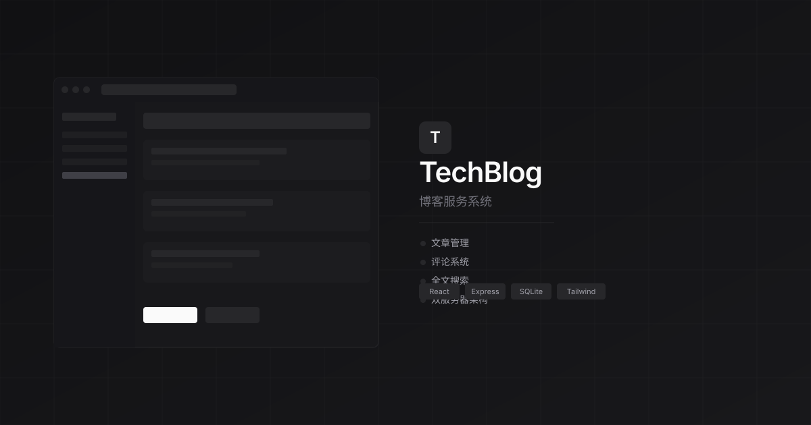

<p align="center">
  
</p>

# Bolg - 博客服务系统

一个轻量级的博客服务系统，支持文章管理、评论、分类标签、全文搜索，采用同源单 Web 服务提供读者站点与作者工作区。

## 技术栈

**前端**
- React 19 + Vite 8
- Tailwind CSS 4
- Lucide React (图标)

**后端**
- Express 5
- SQLite (better-sqlite3)
- 可撤销 Cookie 会话与 CSRF；旧 JWT 过渡兼容
- Sharp (图片处理)

## 功能

- 文章管理（Markdown 支持、草稿/发布状态）
- 评论系统（支持嵌套回复）
- 分类和标签管理
- 全文搜索 (FTS5)
- 图片上传压缩
- 同源作者工作区、独立工作副本与显式发布
- 可配置主题系统
- 响应式设计

## 安装

```bash
npm install
```

## 启动

**开发模式**
```bash
npm run dev
```
- 前端：http://localhost:9099
- 后端 API：http://localhost:9098

**作者工作区**

打开 http://localhost:9099/login，登录后进入 `/studio`。生产使用 http://localhost:9098/login；首次安装见 [迁移与首装](docs/author-workspace-migration.md)。本地 HTTP 设置 `SESSION_COOKIE_SECURE=false`，生产 HTTPS 必须为 true。

**旧管理后台（短期兼容）**
```bash
npm run admin
```
- 管理界面：http://localhost:3033/

**生产构建**
```bash
npm run build
npm start
```

## 项目结构

```
├── src/                    # 前端源码
│   ├── components/         # React 组件
│   │   ├── blog/           # 博客相关组件
│   │   └── layout/         # 布局组件
│   ├── contexts/            # React Context
│   ├── themes/              # 主题配置
│   └── utils/               # 工具函数
│
├── server/                  # 后端源码
│   ├── db/                  # 数据库 DAO
│   ├── middleware/           # Express 中间件
│   ├── routes/              # API 路由
│   └── index-admin.js       # 管理服务器
│
├── admin/                   # 管理后台静态文件
├── scripts/                 # 运维脚本
└── deploy.sh                # 部署脚本
```

## 架构说明

### 单入口与兼容管理

- **Web 服务** (端口 9098)：读者页、登录、作者工作区、API 和上传同源；`npm start` 只启动此服务。
- **旧管理服务器** (端口 3033)：仅短期兼容 JWT；Compose 需显式 `--profile legacy-admin`，宿主仅回环绑定。新工作区不用旧端口授权。

若临时启用旧 3033 管理端，建议仅通过 SSH 隧道访问；新 `/studio` 使用站点 HTTPS 地址：
```bash
ssh -L 3033:127.0.0.1:3033 user@your-server
```

## 环境变量

复制 `.env.example` 为 `.env` 并配置：

```bash
JWT_SECRET=你的密钥（至少32字符）
NODE_ENV=development
PUBLIC_PORT=9098
ADMIN_PORT=3033
```

## 初始化

```bash
# 创建管理员账号
node scripts/init-admin.js
```

## API

| 端点 | 方法 | 说明 |
|------|------|------|
| /api/articles | GET | 获取文章列表 |
| /api/articles/:slug | GET | 获取文章详情 |
| /api/categories | GET | 获取分类 |
| /api/tags | GET | 获取标签 |
| /api/comments/:articleId | GET/POST | 评论 |
| /api/stats/views | GET/POST | 站点访问统计（写入限流） |
| /rss.xml | GET | 已发布文章订阅 |
| /sitemap.xml | GET | 已发布内容站点地图 |
| /robots.txt | GET | 抓取规则 |
| /api/session/login | POST | 浏览器会话登录 |
| /api/auth/login | POST | 旧 JWT 过渡登录 |

## 部署

使用 `deploy.sh` 脚本进行一键部署：

```bash
./deploy.sh
```

部署脚本支持：
- 自动构建前端
- rsync 同步文件
- systemd 服务管理
- 蓝绿发布与回滚

## 生产容器与恢复

运行环境使用 Node 22.22.1，满足 Vite 8 并兼容 better-sqlite3 原生模块。先复制 `.env.example` 到 `.env`，生成 JWT_SECRET，配置 SITE_URL、CORS 白名单及可信代理；数据根目录由 BLOG_DATA_DIR 指定。

```sh
cp .env.example .env
# 编辑 .env，填写随机 JWT_SECRET 和站点地址
docker compose up -d --build
docker compose ps
```

Compose 默认启动 public 和每日 backup（无监听端口），以非 root 用户运行并共享持久数据卷。唯一 Web 端口默认 9098；旧管理界面仅在 `docker compose --profile legacy-admin up -d` 显式启用后通过 http://127.0.0.1:3033/ 访问。重建容器保留卷；不要使用 `docker compose down -v` 删除数据。

在线备份使用 `node scripts/backup-db.js`，经完整性校验和原子落盘后保留最近七天。恢复到全新目录：`node scripts/restore-db.js <快照文件> <新目录>`。备份验证入口为 `node --test tests/backup.test.js`，仅使用临时数据。

完整配置、systemd 每日调度、容器重建验收、上传归档、恢复演练及统计迁移/回滚步骤见 [运维说明](docs/operations.md)。旧 `deploy.sh` 是独立的宿主发布路径；生产配置与数据保护要求仍以运维说明为准。

## 验收测试

```sh
npm ci
npm exec -- playwright install chromium
npm run build
npm test
```

提交到 `tests/*.test.js` 的 Node 测试覆盖 API 权限、统计迁移与并发、管理代理和浏览器交互、备份恢复与服务生命周期。测试使用临时 SQLite/上传目录，不依赖已有博客数据；浏览器阅读验收截图输出到 `test-results/frontend-acceptance/`。仅检查公共服务可运行 `npm run test:platform`。历史根目录 smoke 脚本不作为唯一验收入口。

## 发布集成与迁移

机器 API 默认关闭：`PUBLISHING_API_ENABLED=false`；`LEGACY_JWT_ENABLED=true` 保留旧调用方过渡。只有共享文章服务、会话和发布接口验收后才显式启用机器 API；所有旧调用方迁移且观察窗口无旧请求后才停用 JWT，不因升级更换 JWT_SECRET。

- [发布 API 中文接入指南](docs/api/publishing-v1.md)
- [OpenAPI 3.1](docs/api/publishing-v1.openapi.yaml)
- [账号、草稿、首装与回滚说明](docs/author-workspace-migration.md)

文档中的部署/接入命令供独立测试环境验收使用；不代表已执行容器构建或真实业务数据迁移。
